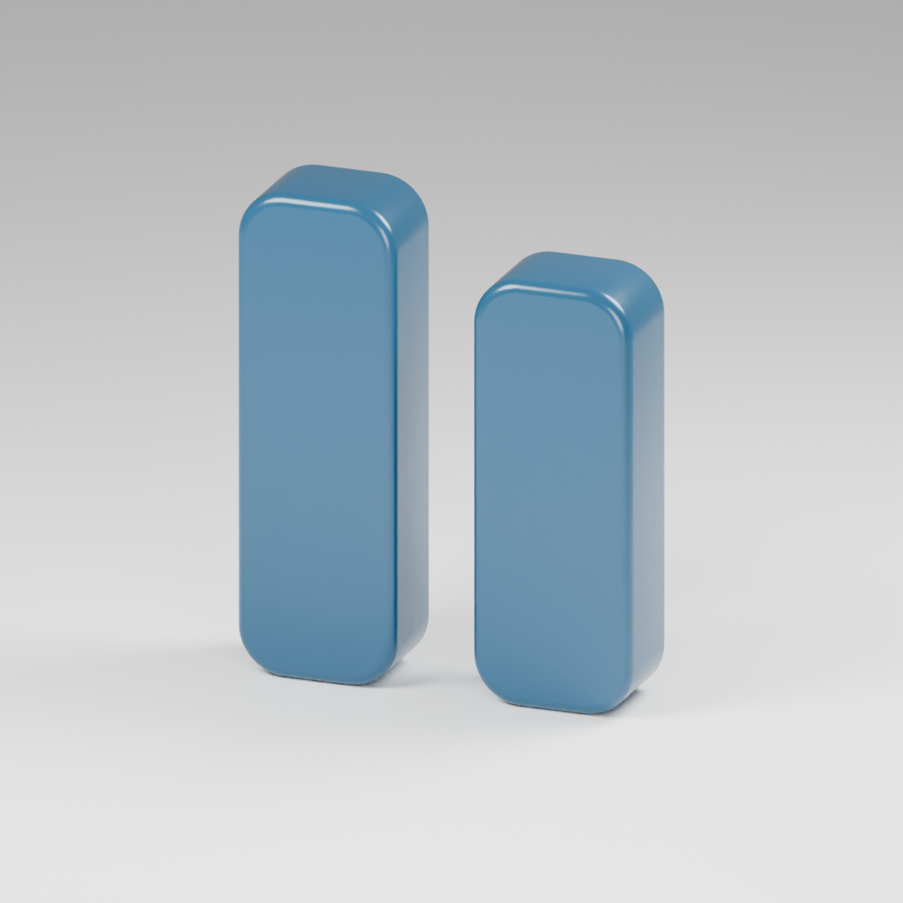

# Timeout

<p align="center">
  
</p>

<p align="center">
  <strong>Decide when distracting apps belong in your day, then let that decision hold.</strong>
</p>

<p align="center">
  <a href="https://github.com/saleke/timeout/releases/download/v0.4.0-early-access/timeout-0.4.0.apk"><strong>Download Timeout for Android</strong></a>
  ·
  <a href="https://github.com/saleke/timeout/releases">All releases</a>
</p>

Timeout is an Android app for creating clear, finite boundaries around distracting apps. It supports focused study sessions, protected work hours, calmer bedtimes, and everyday personal routines in one place.

There are no streaks to maintain and no productivity score to impress. You choose the apps, the time, and the commitment.

## Timeout At A Glance

### Block Now

Choose one or more apps and block opening them:

- For a duration, from 1 minute to 24 hours
- Until an exact time today or tomorrow
- With an explicit final end time before confirmation

Every new block begins with an empty app selection. Apps from another active session are never silently carried into a new timer.

### Build Routines

Create repeating boundaries that fit different parts of your life:

| Context | Example |
| --- | --- |
| **Study** | Block social and video apps during a study window. |
| **Work** | Protect working hours or plan short check-in windows. |
| **Bedtime** | Keep selected apps unavailable overnight. |
| **Personal** | Create a custom boundary for exercise, reading, family time, or anything else. |

Routines support:

- **Protect these hours:** selected apps are blocked during chosen periods.
- **Only allow these hours:** selected apps are available only inside chosen windows.
- Multiple time windows
- Custom repeat days
- Same-day and overnight schedules
- A chosen date when routine settings become editable again

### Understand Every App

Today is app-first. Each currently restricted app shows:

- Its own countdown
- Its absolute next access time
- Every session and routine contributing to that time
- Whether another rule still applies after one timer ends

If Instagram has 15 minutes left but a bedtime routine lasts another hour, Timeout shows the combined access time instead of a misleading first timer.

### Commit Without Confusion

Before starting, Timeout shows the selected apps and the finite end.

Once confirmed, Timeout provides no early-stop, weakening edit, delete, pass, or recovery action inside the app before that commitment ends. Independent sessions and routines remain independent; ending one never clears another.

### Start From Your Home Screen

The quick-block widget lets you create a block without opening the full app:

1. Tap **Pause an app**.
2. Choose the app in a lightweight sheet over Home.
3. Watch the selected app settle into the Interval mark.
4. Choose a duration.
5. Confirm the exact end.

The widget adapts between compact and wide layouts, shows active status, and can display current app icons when the launcher gives it enough space.

Android launchers do not allow ordinary widgets to accept another app icon as a package drop target, so Timeout uses a reliable tap-to-select flow instead of pretending launcher drag-and-drop is supported.

## Built For Interrupted Setup

Android permission setup should not erase your work.

Timeout checkpoints the complete draft before opening Android Settings, including:

- Selected apps
- Duration or exact date/time
- Routine windows and repeat days
- Context and name
- Commitment date
- The screen to return to

If Android recreates the activity or process, Timeout restores that draft. Setup time does not consume a duration. If an exact end passes while you are in Settings, Timeout asks you to choose again rather than silently moving it.

The app picker also keeps search and app rows in one full-height scrolling surface. Only the selected count and confirmation action stay fixed at the bottom.

## Privacy By Default

Timeout works locally and does not require an account.

- No `INTERNET` permission
- No advertising or analytics connection
- Rules and history stay on the device
- App protection does not retrieve screen text or messages
- No screenshots or view-hierarchy capture

Timeout uses Android's accessibility service to observe app/window package transitions and show the blocking screen for selected restricted apps.

## Install The Early-Access APK

Timeout currently supports Android 8.0 and newer.

1. Download [`timeout-0.4.0.apk`](https://github.com/saleke/timeout/releases/download/v0.4.0-early-access/timeout-0.4.0.apk).
2. Open the APK on your Android device.
3. Allow installation from your browser or file manager if Android asks.
4. Open **Timeout**.

This APK is distributed through GitHub while the Google Play release is being prepared.

### Verify The Download

```text
SHA-256: 6144fc1a7eae418b4b47cbb86cd64f00fdb2e87c7d08202a559d1677260c85f3
```

## First Block Setup

1. Tap **Block now**.
2. Select the apps for this session.
3. Choose a duration or exact end time.
4. Tap **Set up blocking**.
5. Enable **Timeout app protection** in Android Accessibility settings.
6. Return to the restored draft.
7. Review and confirm the block.

If Android prevents a downloaded accessibility service from being enabled, open **Android won't let me enable it** in Timeout. Some devices require:

```text
App info → menu → Allow restricted settings
```

## Appearance And Interaction

Timeout uses a restrained deep-ocean-blue identity on warm neutral surfaces.

- Light, dark, and system appearance
- Scalable Android text
- 48 dp or larger interaction targets
- Native Material controls and time pickers
- Reduced page-motion preference
- Opaque directional page transitions
- Balanced choice cards that fill every wrapped row

## Build From Source

Requirements:

- JDK 17
- Android SDK 37

```bash
./gradlew --no-daemon --console=plain \
  :core:test \
  :app:testDebugUnitTest \
  :app:assembleDebug \
  :app:assembleDebugAndroidTest \
  :app:lintDebug
```

APK output:

```text
app/build/outputs/apk/debug/timeout-0.4.0.apk
```

## Project Status

Timeout 0.4.0 is an early-access Android build. The source includes automated policy, commitment, draft-restoration, time-selection, and adaptive-layout tests.

Issues and feedback are welcome through [GitHub Issues](https://github.com/saleke/timeout/issues).

## License

See [LICENSE](LICENSE).
